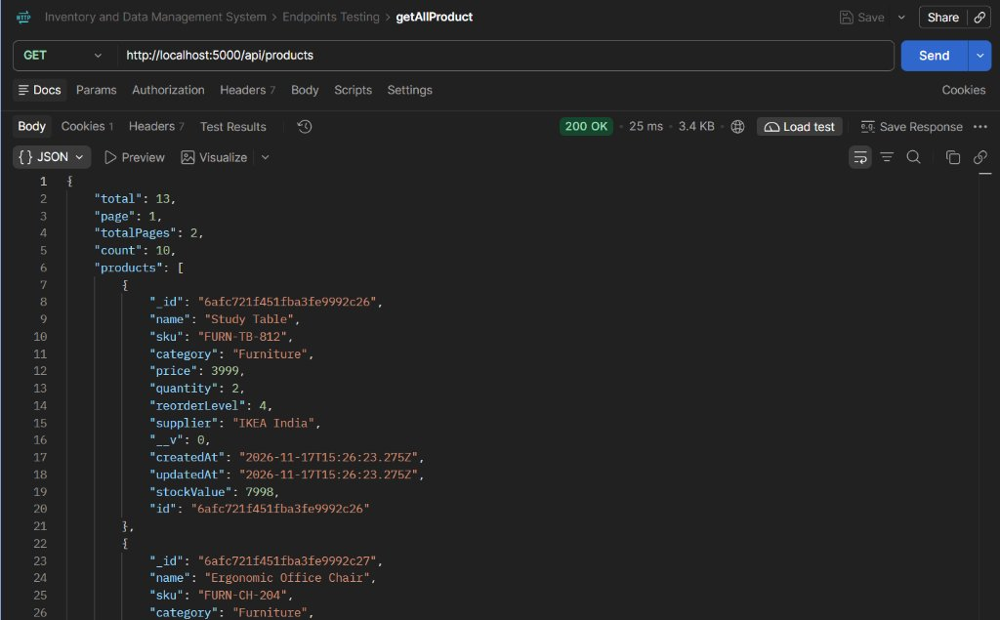
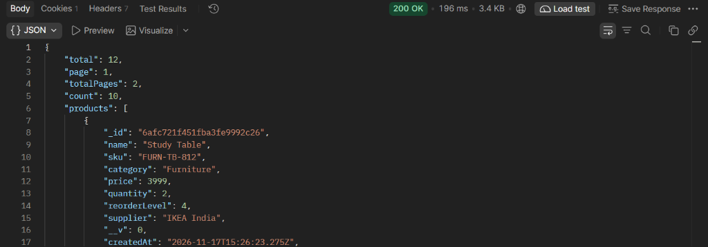
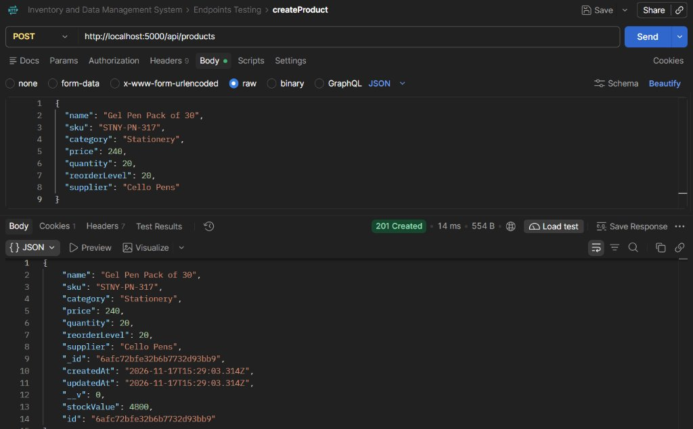
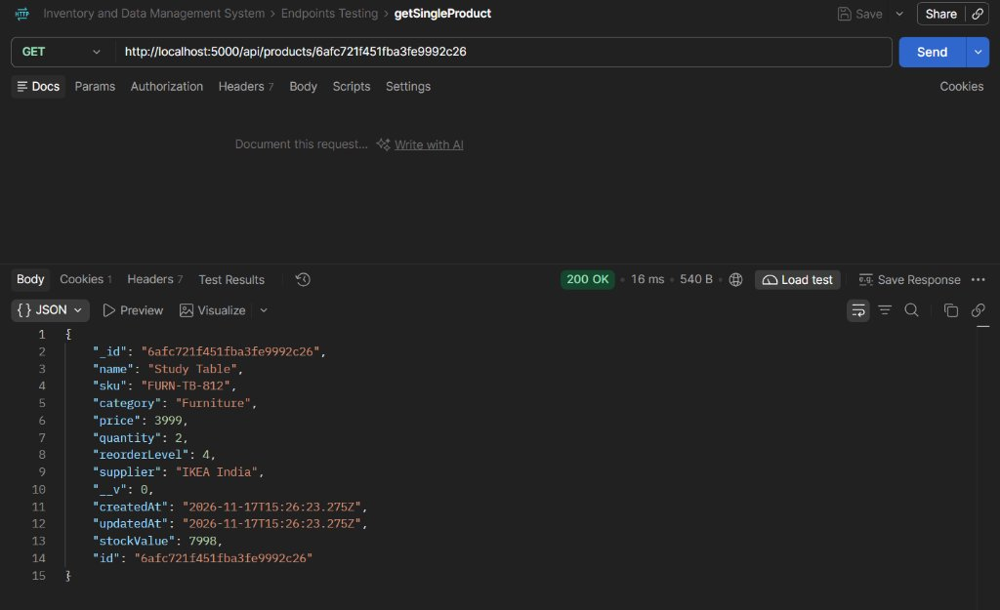
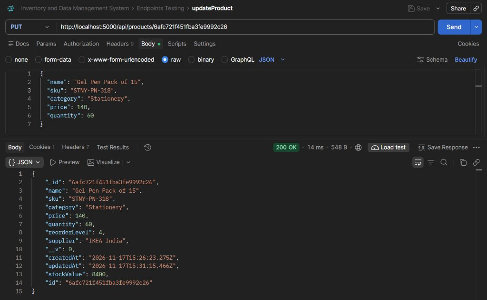
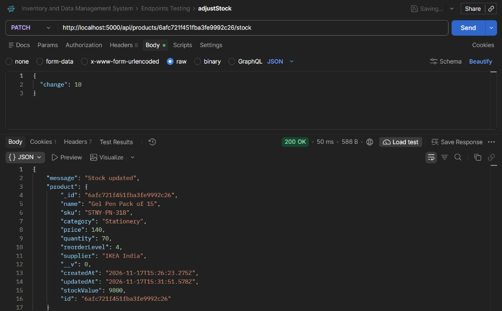
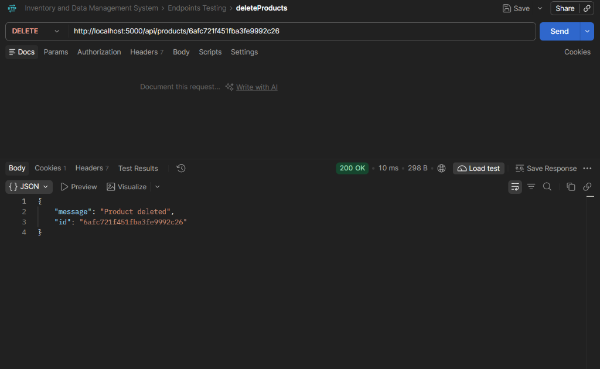
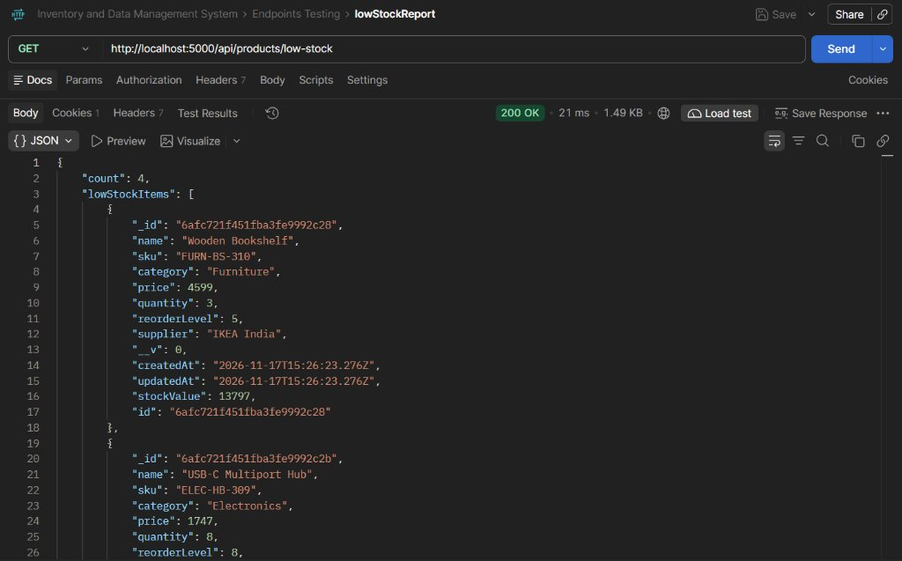
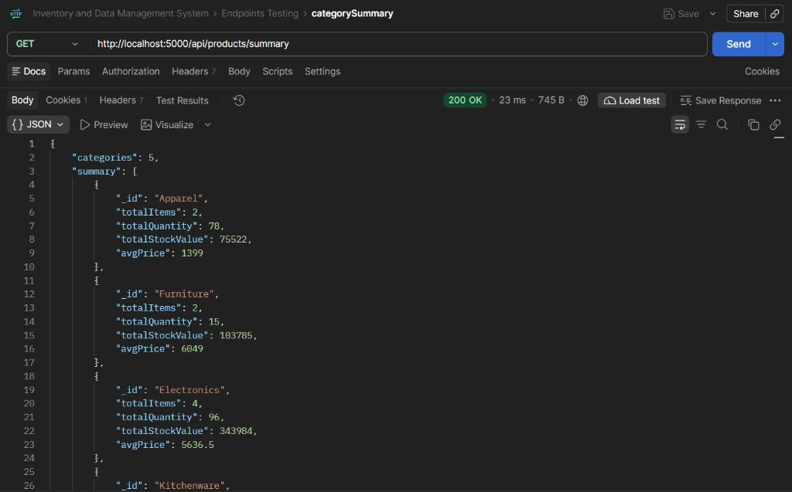

# Assignment 3: Inventory and Data Management System

| Field | Details |
| :--- | :--- |
| **Course** | Web Dev III (Node.js and Express Backend) |
| **Unit Covered** | Unit – 3 |
| **CO Mapping** | CO3 |
| **Topic** | Inventory and Data Management System |

---

## Overview

The **Inventory and Data Management System** is a RESTful backend built using **Node.js**, **Express.js**, and **MongoDB (Mongoose)**. It allows a store or warehouse to manage its product catalogue — creating products, updating stock levels safely (restock and sale operations), searching/filtering/sorting/paginating the catalogue, and generating low-stock alert reports and category-wise inventory summaries using MongoDB aggregation pipelines.

---

## Technology Stack

- **Node.js** – Server-side runtime environment
- **Express.js** – Backend routing and middleware
- **MongoDB** – NoSQL document database for persistent storage
- **Mongoose** – Schema definition, field-level validation, virtuals, and aggregation querying (ODM)
- **dotenv** – Environment variable management

---

## Project Structure

```text
Lab Assignment 3/
├── config/
│   └── db.js                        # MongoDB connection configuration
├── controllers/
│   └── productController.js         # CRUD, filtering/sorting/pagination, stock adjustment & aggregation
├── middleware/
│   ├── errorMiddleware.js           # Centralized error handling & 404 middleware
│   └── validationMiddleware.js      # Request input validation middleware
├── models/
│   └── Product.js                   # Mongoose Product schema, validation & stockValue virtual
├── routes/
│   └── productRoutes.js             # Express API routes (/api/products)
├── screenshots/                     # Postman output screenshots
├── .env.example                     # Sample environment variables
├── .gitignore                       # Ignored files for Git
├── package.json                     # Project metadata and dependencies
├── seed.js                          # Database seeder with 12 sample products
└── server.js                        # Application entry point
```

---

## Installation & Setup

1. **Clone the repository:**
   ```bash
   git clone <your-github-repo-url>
   cd "Lab Assignment 3"
   ```

2. **Install dependencies:**
   ```bash
   npm install
   ```

3. **Configure environment variables:**
   Create a `.env` file in the root directory (or copy `.env.example`):
   ```env
   PORT=5000
   MONGO_URI=mongodb://127.0.0.1:27017/inventory_db
   ```

4. **Seed the database with sample products (Optional):**
   ```bash
   npm run seed
   ```

5. **Start the server:**
   ```bash
   npm start
   ```
   The API will run at `http://localhost:5000`.

---

## API Endpoints Reference

| Method | Endpoint | Description |
| :--- | :--- | :--- |
| `GET` | `/api/products` | Get all products (supports filtering, sorting & pagination) |
| `POST` | `/api/products` | Create a new product |
| `GET` | `/api/products/:id` | Get a single product by ID |
| `PUT` | `/api/products/:id` | Update product details by ID |
| `PATCH` | `/api/products/:id/stock` | Adjust product stock safely (`{ "change": 10 }` or `{ "change": -5 }`) |
| `DELETE` | `/api/products/:id` | Delete a product by ID |
| `GET` | `/api/products/low-stock` | Get low-stock alert report (`quantity <= reorderLevel`) |
| `GET` | `/api/products/summary` | Get category-wise inventory summary (Aggregation Pipeline) |

### Query Parameters for `GET /api/products`
- `page` & `limit` — Pagination (e.g., `?page=1&limit=10`)
- `category` — Filter by category (e.g., `?category=Furniture`)
- `supplier` — Filter by supplier (e.g., `?supplier=IKEA`)
- `search` — Search by product name or SKU (e.g., `?search=Table`)
- `minPrice` & `maxPrice` — Price range filter (e.g., `?minPrice=500&maxPrice=5000`)
- `inStock` — Stock availability (`?inStock=true` or `?inStock=false`)
- `sort` — Sort fields (e.g., `?sort=price` or `?sort=-price`)

---

## Postman Output Screenshots

### 1. Get All Products — Filtering, Sorting & Pagination (`GET /api/products`)




### 2. Create Product (`POST /api/products`)


### 3. Get Single Product by ID (`GET /api/products/:id`)


### 4. Update Product Details (`PUT /api/products/:id`)


### 5. Stock Adjustment — Restock / Sale (`PATCH /api/products/:id/stock`)


### 6. Delete Product (`DELETE /api/products/:id`)


### 7. Low-Stock Alert Report (`GET /api/products/low-stock`)


### 8. Category-wise Inventory Summary (`GET /api/products/summary`)

